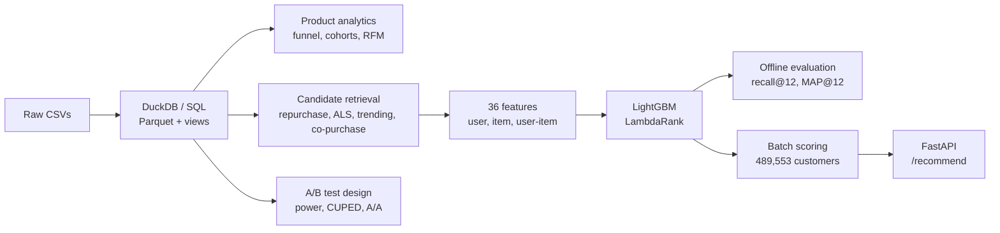
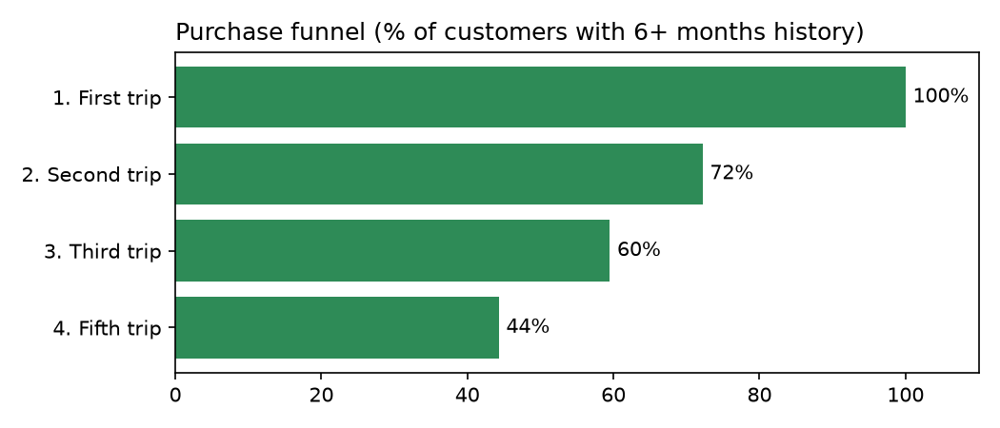
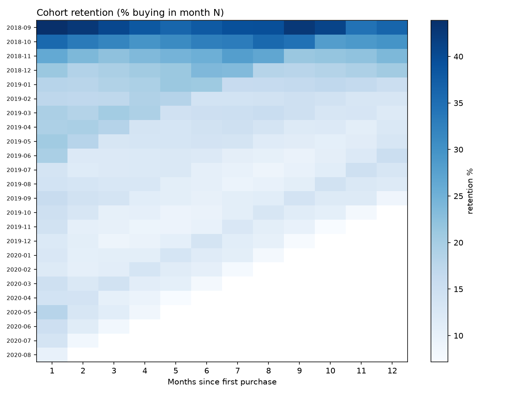
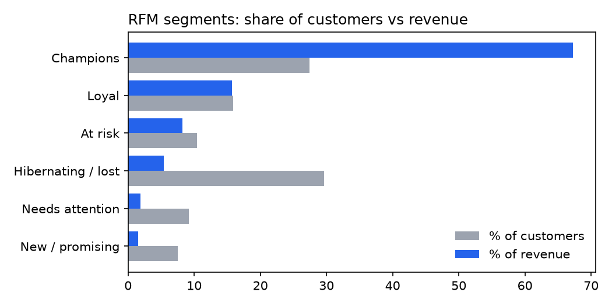
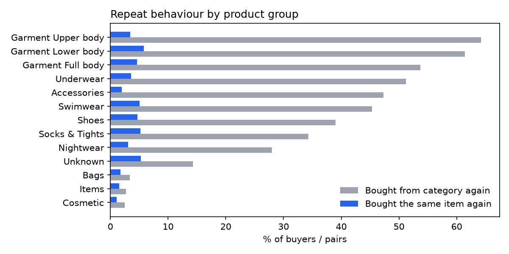

# H&M Recommender & Product Analytics

> End-to-end retail analytics and personalised recommendations on **31.8M H&M transactions**: SQL product analytics, a two-stage recommender (candidate retrieval + LightGBM LambdaRank), a data-driven A/B test design, batch scoring for 489,553 customers, and a FastAPI service.

   

## Results at a glance

| | |
|---|---|
| **Recommender** | recall@12 **0.0638**, MAP@12 **0.0305**: **+21% / +18%** over the best heuristic, **2.5x / 3.5x** over popularity |
| **Customer insight** | **27.8%** of customers never make a second purchase; **27%** of customers generate **67%** of revenue |
| **A/B design** | 30-day repeat rate baseline **48.88%**; **36,793** customers per arm (with CUPED) to detect a **2%** relative lift |
| **Serving** | Recommendations for **489,553** active customers, served by a FastAPI service with cold-start fallback |

---

## 1. Business problem

Many customers buy once and never return. Two questions:

1. **Where do customers drop off?** (funnel, cohort retention, RFM, category repeat behaviour)
2. **Can personalised recommendations bring them back?** (recommender + experiment design)

**Offline metric:** recall@12 and MAP@12 (the Kaggle competition metric) on a held-out week.
**Online metric:** 30-day repeat-purchase rate, measured with the A/B test in section 6.

## 2. Data

[H&M Personalized Fashion Recommendations](https://www.kaggle.com/competitions/h-and-m-personalized-fashion-recommendations) (Kaggle)

| Fact | Value |
|---|---|
| Transactions | 31,788,324 |
| Customers who bought | 1,362,281 (of 1,371,980 registered) |
| Articles sold | ~104,500 |
| Period | 20 Sep 2018 – 22 Sep 2020 (733 days) |
| Channel | 70.4% online, 29.6% in-store |

Prices are scaled by H&M, so they are only used for comparisons, never as currency.

**Validation is strictly time-based.** Weeks are counted back from the last day (week 0 = the final 7 days). Features and candidates for a label week use only the 12 weeks before it, so no future data leaks in.

## 3. Architecture



## 4. Product analytics (SQL on DuckDB)

Queries are in [`sql/`](sql/); charts are in [`reports/figures/`](reports/figures/).

| Question | Finding |
|---|---|
| How many never return? | **27.8%** of customers with 6+ months of history made only one trip (32.9% before correcting for right-censoring) |
| Where is the biggest drop? | First → second trip: only **72.2%** come back; then 82.3% make a third |
| How fast does retention fall? | Median cohort retention **14.8%** in month 1, **12.1%** in month 3 (cohorts from Dec 2018; earlier cohorts are left-censored) |
| Who drives revenue? | **Champions: 27.4% of customers, 67.3% of revenue**; At risk: 141,268 customers who last bought ~1 year ago |
| Do people rebuy? | Up to **64%** return to a category, but at most **5.8%** rebuy the same item |






## 5. Recommender

### Evaluation set-up
Test week: the final 7 days, **68,984** customers. 71.3% of them bought in the previous 12 weeks; 8.1% are true newcomers.

### Stage 1: candidate retrieval (~131 per customer)

| Source | Logic | Candidate recall |
|---|---|---|
| Repurchase | Customer's own items from the last 12 weeks, most recent first | 0.0378 |
| ALS | Implicit-feedback matrix factorisation (`implicit`), 64 factors, 28-day half-life weights | 0.0379 |
| Trending | Last week's top 100 | 0.0511 (top 30) |
| Co-purchase | Items bought in the same basket as the customer's 5 most recent items | adds +0.014 |
| **All four** | | **0.1764** (the ceiling for the ranker) |

### Stage 2: LightGBM LambdaRank ranker
- **36 features:** source ranks/scores, user (trips, recency, price level, age, online share), item (1/4/12-week sales, trend, price, buyer age), user × item (category share, price ratio, age gap).
- **Training:** label weeks 1–3, customers with at least one bought candidate, all positives + 30% of negatives (3.15M rows).

### Results (test week)

| Strategy | recall@12 | MAP@12 |
|---|---|---|
| Global popularity (all history) | 0.0077 | 0.0029 |
| Recent popularity (last week) | 0.0255 | 0.0087 |
| Repurchase, then recent popularity | 0.0525 | 0.0258 |
| **LightGBM ranker** | **0.0638** | **0.0305** |

**Top features (share of gain):** `rep_rank` 22.4%, `u_days_since_last` 9.1%, `cop_score` 6.3%, `i_trend` 6.3%, `i_cnt_1w` 5.1%.
Repurchase dominates; item momentum (trend, last-week sales) adds about 15%. Category affinity and ALS score matter less than expected, likely because the candidate sources already reflect each customer's categories.

## 6. A/B test design

Full report: [`reports/ab_test_design.md`](reports/ab_test_design.md).

| Item | Design |
|---|---|
| Hypothesis | Personalised post-purchase recommendations increase the 30-day repeat-purchase rate vs popularity |
| Unit | Customer, 50/50 split on a hash of `customer_id` |
| Primary metric | Repeat purchase within 30 days |
| Baseline | **48.88%** (8 weeks, range 48.06–49.58%) |
| Minimum detectable effect | **2% relative** (+0.98 points) |
| Significance / power | α = 0.05 (two-sided) / 80% |
| Sample size | **36,793 per arm with CUPED** (41,062 without; ρ = 0.322 removes 10.4% of variance) |
| Duration | 2 weeks of enrolment + 30 days of follow-up |
| A/A check | 5.5% false positives over 1,000 random splits (expected 5%) |

> This is an experiment **design**. A public dataset has no live traffic.

## 7. Serving

Recommendations are **batch-scored** on the latest 12 weeks (the standard pattern for fashion, which changes weekly) and served from a lookup table. The serving pipeline reuses the training feature code, to avoid training–serving skew.

```bash
uvicorn src.api.main:app --reload       # then open http://127.0.0.1:8000/docs
```

| Endpoint | Returns |
|---|---|
| `GET /health` | Status, number of customers, date of the latest data |
| `GET /recommend/{customer_id}?k=12` | 12 personalised items, or last week's best-sellers for unknown customers (`"source": "cold_start"`) |

Tests: `python -m pytest -q` (5 tests). A `Dockerfile` is included for containerised deployment.

## 8. Repository structure

```
├── sql/                      # funnel, cohort retention, RFM, category repeat
├── notebooks/
│   ├── 01_eda.ipynb
│   ├── 02_product_analytics.ipynb
│   ├── 03_evaluation.ipynb           # time split, metrics, baselines
│   ├── 04_candidates.ipynb           # candidate sources + LightGBM ranker (Colab)
│   ├── 06_ab_test.ipynb
│   └── 07_batch_recommendations.ipynb  (Colab)
├── src/
│   ├── metrics.py            # recall@k, MAP@k, evaluate()
│   └── api/main.py           # FastAPI service
├── tests/test_api.py
├── reports/                  # A/B design report, figures
├── Dockerfile, requirements.txt, requirements-api.txt
```

## 9. How to run

1. `pip install -r requirements.txt`, and download the three CSVs from Kaggle into `data/raw/`.
2. Run notebooks 01 → 03 on a laptop (DuckDB with a memory limit).
3. Run the candidate/ranker and batch notebooks on Google Colab (13 GB RAM); they write `ranker.txt`, `recommendations.parquet` and `cold_start.json`.
4. Put those three files in `data/artifacts/` and start the API.

## 10. Limitations and next steps

- Offline evaluation on a single test week; online impact needs the A/B test.
- Hyperparameters are defaults; tuning on a validation week is the next step.
- The ranker reaches 36% of the candidate ceiling, so better ranking features are the biggest lever.
- Trending candidates could be personalised by age group to cut candidate count.

---

**Author:** Aparna Ramesh · [LinkedIn](https://www.linkedin.com/in/aparna-ramesh-/)
