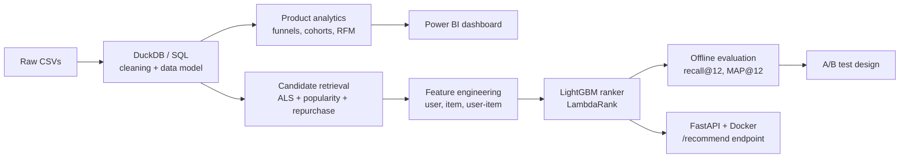

# E-commerce Recommender & Product Analytics

> End-to-end retail analytics and personalised recommendation system on **31M+ H&M transactions**: from SQL funnel and retention analysis to a two-stage recommender, an A/B test design, and a deployed API.

    


---

## 1. Business problem

Most e-commerce customers buy once and never return. The goal is to answer two questions:

1. **Where are customers dropping off?** (funnel, cohort and retention analysis)
2. **Can personalised recommendations increase repeat purchases?** (recommender + experiment design)

**Success metric:** recall@12 offline. In production, the primary metric would be repeat-purchase rate, measured through an A/B test.

---

## 2. Dataset

[H&M Personalized Fashion Recommendations](https://www.kaggle.com/competitions/h-and-m-personalized-fashion-recommendations) (Kaggle)

| Table | Rows | Content |
|---|---|---|
| `transactions` | ~31.8M | customer, article, date, price, channel |
| `customers` | ~1.37M | age, membership status, activity flags |
| `articles` | ~105K | product type, colour, department, description |

**Period:** Sep 2018 – Sep 2020
**Validation:** time-based split. Train on history up to week *t*, predict purchases in week *t+1*. There is no random split, which avoids leakage.

---

## 3. Architecture



---

## 4. Product analytics (SQL)

All analysis is in [`sql/`](sql/), run on DuckDB.

- **Funnel:** first purchase → second purchase → 3+ purchases
- **Cohort retention:** monthly acquisition cohorts, retention curves
- **RFM segmentation:** recency, frequency and monetary segments, and their share of revenue
- **Category analysis:** repurchase rate by product type and department

📊 **Dashboard:** [Power BI link or screenshot](docs/dashboard.png)

---

## 5. Recommender system

### Stage 1: Candidate retrieval (~100 per user)
| Source | Logic |
|---|---|
| Repurchase | Items the user bought before (strong signal in fashion) |
| ALS collaborative filtering | Implicit-feedback matrix factorisation (`implicit` library) |
| Trending | Top-selling items in the last week |
| Co-purchase | Items frequently bought together with the user's recent items |

### Stage 2: Ranking (LightGBM, LambdaRank objective)
**Features ([X] total):**
- **User:** purchase count, recency, average price, age, channel preference
- **Item:** popularity trend, price, product type, age of article
- **User–item:** ALS score, days since last purchase of the item, category affinity

### Cold start
New users get trending items, segmented by age group. New items are scored using content features (product type, colour, department).

---

## 6. Offline evaluation

- **Metrics:** recall@12, MAP@12, precision@12, catalogue coverage
- **Baselines:** global popularity, recent popularity
- **Ablation:** contribution of each candidate source and feature group

| Ablation | Recall@12 |
|---|---|
| Popularity only | [X] |
| + Repurchase candidates | [X] |
| + ALS candidates | [X] |
| + LightGBM ranker | **[X]** |

---

## 7. A/B test design

Offline lift does not guarantee online lift, so this is the experiment that would validate the recommender in production.

| Item | Design |
|---|---|
| **Hypothesis** | Personalised recommendations increase 30-day repeat-purchase rate vs popularity-based recommendations |
| **Unit** | Customer (randomised by customer ID hash) |
| **Primary metric** | 30-day repeat-purchase rate |
| **Secondary metrics** | Click-through rate, revenue per user, basket size |
| **Guardrails** | Return rate, page latency, catalogue diversity |
| **Baseline rate** | [X]% (from historical data) |
| **Minimum detectable effect** | [X]% relative |
| **Power / significance** | 80% / α = 0.05 |
| **Required sample** | [X] customers per arm |
| **Duration** | [X] weeks (covers weekly seasonality) |

Power calculations are in [`notebooks/05_ab_test_design.ipynb`](notebooks/05_ab_test_design.ipynb).

> Note: this is an experiment **design**. No live traffic is available for a public dataset.

---

## 8. Serving

```bash
docker build -t hm-recommender .
docker run -p 8000:8000 hm-recommender
```

```bash
curl http://localhost:8000/recommend/{customer_id}?k=12
```

Response:
```json
{
  "customer_id": "abc123",
  "recommendations": ["0706016001", "0372860001", "..."],
  "source": "personalised"
}
```

---

## 9. Repository structure

```
├── data/                  # raw and processed data (not committed; see setup)
├── sql/                   # funnel, cohort, RFM queries
├── notebooks/
│   ├── 01_eda.ipynb
│   ├── 02_product_analytics.ipynb
│   ├── 03_candidate_generation.ipynb
│   ├── 04_ranking_model.ipynb
│   └── 05_ab_test_design.ipynb
├── src/
│   ├── data/              # loading and cleaning
│   ├── features/          # feature engineering
│   ├── models/            # ALS, LightGBM ranker
│   ├── evaluation/        # recall@k, MAP@k
│   └── api/               # FastAPI app
├── tests/
├── docs/                  # dashboard screenshots, diagrams
├── Dockerfile
├── requirements.txt
└── README.md
```

---

## 10. Setup

```bash
git clone https://github.com/your-username/ecommerce-recommender.git
cd ecommerce-recommender
pip install -r requirements.txt

# Download data from Kaggle into data/raw/
kaggle competitions download -c h-and-m-personalized-fashion-recommendations -p data/raw

python -m src.data.prepare      # clean and build DuckDB tables
python -m src.models.train      # train retrieval + ranker
python -m src.evaluation.run    # offline metrics
uvicorn src.api.main:app        # serve locally
```

---

## 11. Limitations and next steps

- Offline metrics only. Online impact needs the A/B test above.
- Image and text embeddings for articles are not yet used. They would help cold-start items.
- Add MLflow experiment tracking and drift monitoring for production readiness.

---

## Tech stack

**Data:** Python, Pandas, DuckDB (SQL) · **ML:** implicit (ALS), LightGBM, scikit-learn · **Stats:** SciPy, statsmodels · **Serving:** FastAPI, Docker · **BI:** Power BI

---

**Author:** Aparna Ramesh · [LinkedIn](https://linkedin.com/in/your-profile)
